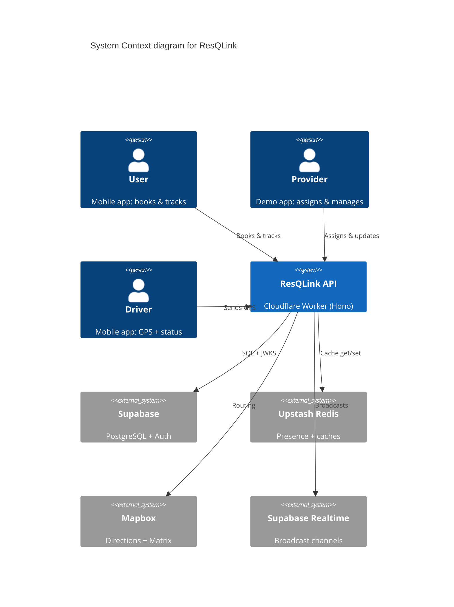
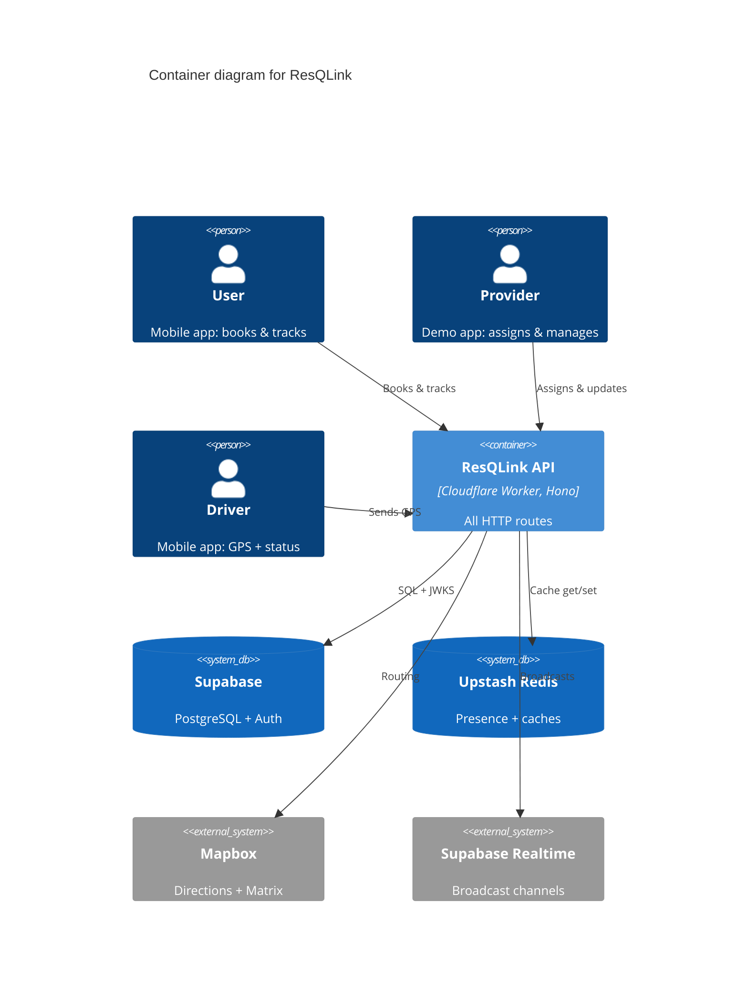
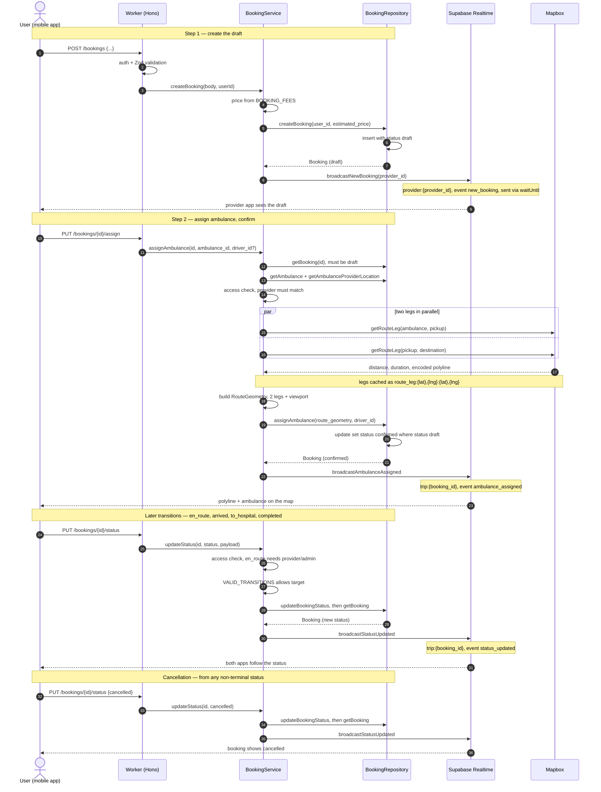
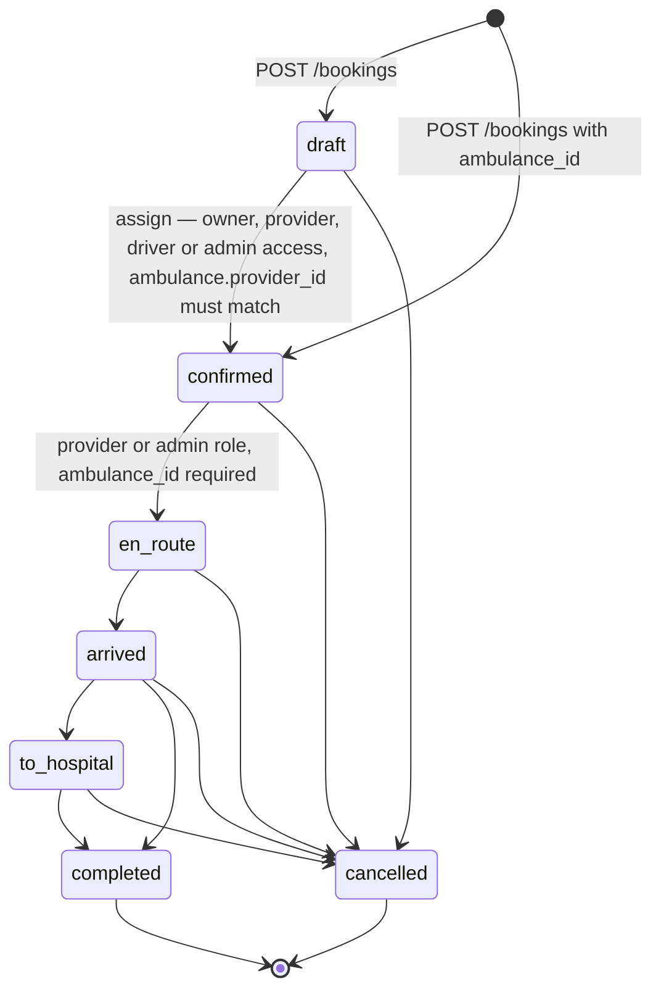

# ResQLink Architecture — C4 Views

ResQLink is an on-demand ambulance dispatch backend: one Cloudflare Worker (Hono, TypeScript) that serves the user, provider and driver apps and talks to Supabase, Upstash Redis, Mapbox, and Supabase Realtime.

---

## C4 Level 1 — System Context

This shows the actors, the single deployable system, and its four external services; the driver's GPS updates enter at the Worker and reach the user app as Realtime broadcasts on `trip:{bookingId}`, which the apps subscribe to directly.

---

## C4 Level 2 — Container

This shows the internals of the system: a single Worker container handling all HTTP traffic, with the middleware wired in `backend/src/index.ts` and no other deployable unit.

---

## C4 Level 3 — Component

Opening up the Worker: the middleware chain runs in the order registered on the Hono app in `backend/src/index.ts`, then each mounted sub-app resolves its services through the DI getters and reaches the database only through a repository interface.

```mermaid
C4Component
    title Component diagram — ResQLink Cloudflare Worker

    Container_Boundary(worker, "Cloudflare Worker", "Hono + TypeScript") {
        Container_Boundary(middleware, "Middleware chain (src/index.ts order)") {
            Component(cors, "1 · CORS", "hono/cors", "ALLOWED_ORIGINS allowlist")
            Component(requestId, "2 · Request ID", "inline middleware", "x-request-id header")
            Component(envCheck, "3 · Env validation", "Zod envSchema", "500 CONFIGURATION_ERROR")
            Component(di, "4 · DI", "middleware/di.ts", "lazy getters per request")
            Component(rateLimit, "5 · Rate limiting", "RL_DEFAULT / RL_DRIVER", "keyed by client IP, 429")
            Component(logging, "6 · Logging", "utils/logger.ts", "method, path, status, duration")
            Component(auth, "7 · supabaseAuth", "verifyWithJwks", "ES256 only, /bookings + /driver")
            Component(errorHandler, "8 · Error handler", "app.onError", "404 / 403 / 400 / 500 JSON")
        }
        Component(router, "Hono router", "app.route()", "mounts five sub-apps")
        Container_Boundary(routes, "Routes — HTTP handlers + Zod") {
            Component(bookingRoutes, "Booking routes", "routes/bookings.ts", "CRUD, assign, status")
            Component(driverRoutes, "Driver routes", "routes/driver.ts", "location, assignments, track, status")
            Component(readRoutes, "Discovery, provider and hospital routes", "routes/discovery.ts, providers.ts, hospitals.ts", "nearby, search")
        }
        Container_Boundary(services, "Services — business logic") {
            Component(bookingService, "BookingService", "services/bookings.ts", "draft, assign, VALID_TRANSITIONS")
            Component(dispatchService, "DispatchService", "services/dispatch.ts", "H3 ambulance search")
            Component(providerService, "ProviderService", "services/providers.ts", "search, nearby")
            Component(hospitalService, "HospitalService", "services/hospitals.ts", "search, nearby")
            Component(distanceService, "DistanceService", "services/distance.ts", "route legs, Redis cache")
            Component(driverService, "DriverService", "services/driver.ts", "GPS, assignments, availability")
        }
        Container_Boundary(repositories, "Repositories — interfaces only") {
            Component(bookingRepoIface, "Booking and ambulance interfaces", "IBookingRepository, IAmbulanceRepository", "create, assign, availability")
            Component(discoveryIface, "Discovery interfaces", "IProviderRepository, IHospitalRepository", "search, H3 lookup")
            Component(realtimeIface, "IRealtimeBroadcaster", "repositories/realtime.ts", "new booking, assigned, status, location")
            Component(mapsCacheIface, "Maps and cache interfaces", "IMapsRepository, IGenericCache", "directions, matrix, get and set")
            Component(driverIface, "Driver interfaces", "IDriverRepository, IDriverLocationRepository", "availability, latest GPS")
        }
        Container_Boundary(infrastructure, "Infrastructure — implementations") {
            Component(supabaseRepos, "Supabase repositories", "supabase/booking, ambulance, provider, hospital", "SupabaseClientBase plus Zod parsing")
            Component(realtimeRepo, "RealtimeBroadcaster", "supabase/realtime.ts", "REST channel.send")
            Component(redisRepo, "UpstashRedisRepository", "upstash.ts", "Redis REST client")
            Component(mapboxRepo, "MapboxRepository", "mapbox.ts", "Directions, Matrix")
            Component(driverRepos, "Driver repositories", "driver-repo.ts, driver-location.ts", "drivers table, cache plus inserts")
        }
    }

    Container_Boundary(external, "External systems") {
        ComponentDb_Ext(postgres, "Supabase Postgres", "PostgreSQL", "bookings, providers, ambulances, hospitals, drivers, driver_locations")
        ComponentDb_Ext(redis, "Upstash Redis", "Redis REST", "driver:location:*, route_leg:*")
        Component_Ext(mapbox, "Mapbox", "HTTP API", "Directions, Matrix")
        Component_Ext(realtime, "Supabase Realtime", "Broadcast REST", "trip:{booking_id}, provider:{provider_id}")
    }

    Rel(cors, requestId, "next()")
    Rel(requestId, envCheck, "next()")
    Rel(envCheck, di, "next()")
    Rel(di, rateLimit, "next()")
    Rel(rateLimit, logging, "next()")
    Rel(logging, auth, "next()")
    Rel(auth, router, "jwtPayload")
    Rel(router, bookingRoutes, "/bookings")
    Rel(router, driverRoutes, "/driver")
    Rel(router, readRoutes, "/ambulances, /providers, /hospitals")
    Rel(bookingRoutes, bookingService, "create, assign, status")
    Rel(driverRoutes, driverService, "location, assignments")
    Rel(driverRoutes, bookingService, "getBooking for track")
    Rel(readRoutes, dispatchService, "findNearbyAmbulances")
    Rel(readRoutes, providerService, "search, nearby")
    Rel(readRoutes, hospitalService, "search, nearby")
    Rel(bookingService, bookingRepoIface, "book, assign")
    Rel(bookingService, realtimeIface, "broadcast")
    Rel(bookingService, distanceService, "two route legs")
    Rel(bookingService, errorHandler, "typed errors")
    Rel(distanceService, mapsCacheIface, "directions and cache")
    Rel(dispatchService, bookingRepoIface, "available ambulances")
    Rel(dispatchService, distanceService, "enrich")
    Rel(providerService, discoveryIface, "search")
    Rel(hospitalService, discoveryIface, "search")
    Rel(driverService, driverIface, "GPS, availability")
    Rel(driverService, bookingRepoIface, "assignments")
    Rel(driverService, realtimeIface, "location_update")
    Rel(supabaseRepos, bookingRepoIface, "implements")
    Rel(supabaseRepos, discoveryIface, "implements")
    Rel(realtimeRepo, realtimeIface, "implements")
    Rel(redisRepo, mapsCacheIface, "implements")
    Rel(mapboxRepo, mapsCacheIface, "implements")
    Rel(driverRepos, driverIface, "implements")
    Rel(supabaseRepos, postgres, "SQL")
    Rel(realtimeRepo, realtime, "channel.send")
    Rel(redisRepo, redis, "Redis REST")
    Rel(mapboxRepo, mapbox, "HTTP")
    Rel(driverRepos, postgres, "drivers, driver_locations")
    Rel(driverRepos, redis, "latest location")
    Rel(errorHandler, router, "JSON error response")
```

Every dependency in the graph is resolved by `diMiddleware`: each `get…` getter builds its repository or service once per request, so services only ever see the repository interfaces and never a concrete Supabase, Redis or Mapbox class.

---

## Booking flow — sequence

Two-step booking: `POST /bookings` persists a draft, `PUT /bookings/:id/assign` resolves both route legs, stores `route_geometry` and flips the booking to `confirmed` in one update.

`updateStatus` always re-reads the booking after the write and broadcasts the persisted row, so clients never see a status the database rejected.

---

## Booking state machine

Reproduced from `VALID_TRANSITIONS` in `backend/src/services/bookings.ts`: `draft` and the two terminal states, with `arrived` also allowed to complete directly.

Only `en_route` carries a role gate (`isProviderRole` or `isAdminRole`); the other transitions rely on `canAccessBooking`, which admits the booking owner, the matching provider, the assigned driver, and admins.
